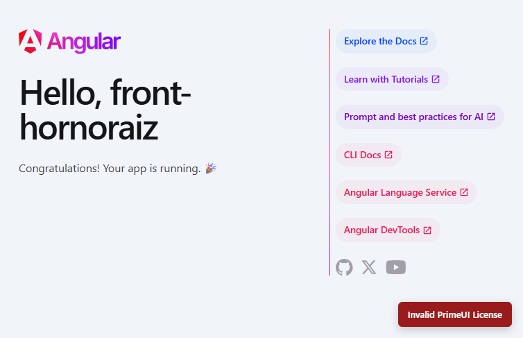

```{r setup, include=FALSE}
knitr::opts_chunk$set(echo = TRUE, warning = FALSE, message = FALSE)
```

# Introducción y Arquitectura del Sistema

El proyecto **HornoRaíz** es una plataforma web modular para la gestión integral de producción y ventas en panaderías y reposterías artesanales. El ecosistema tecnológico se divide en dos capas desacopladas:

1. **Backend (API REST):** Desarrollado con **NestJS** y **Sequelize ORM**, ejecutándose en el puerto `3004` bajo el prefijo global `/api` con control de acceso basado en roles y recursos (RBAC).
2. **Frontend (SPA):** Desarrollado con **Angular 22** (arquitectura standalone, signals y reactividad moderna), estilizado mediante el patrón *"sin CSS propio"* combinando **PrimeNG (Aura theme)** y **Tailwind CSS 4**.
3. **Entorno de Desarrollo:** Ubuntu 26.04 bajo WSL 2 integrado con Windows 11 y RStudio.

---

# Fase 0 · Fundamentos

## ISS-00: Requisitos Previos y Preparación del Entorno

### Objetivo del ISS
Garantizar la disponibilidad de las herramientas de construcción frontend (Node, npm, Angular CLI), confirmar el funcionamiento y protección del backend NestJS en el puerto `3004`, y validar el flujo de credenciales y roles (ADMIN y SELLER) antes de comenzar la codificación de componentes.

### Tabla de Criterios de Aceptación (ISS-00) — Estado Consolidado

| Criterio | Descripción | Estado | Resultado Obtenido |
| :--- | :--- | :---: | :--- |
| **0.1 Herramientas** | `node -v`, `npm -v` y `ng version` cumplen engines | **Cumplido** | Node v24.22.1, npm 12.2.0, Angular CLI 22.2.3 |
| **0.2 Backend Activo** | Backend escuchando en puerto 3004 y BD conectada | **Cumplido** | NestJS activo en `http://localhost:3004/api` |
| **0.2 Protección API** | `GET /api/clients` sin token responde 401 | **Cumplido** | `401 Unauthorized` (`Missing Bearer token`) |
| **0.3 Login Admin** | `admin` / `Admin123!` genera tokens | **Cumplido** | `200 OK` con `access_token` y `refresh_token` |
| **0.3 Perfil Admin** | `GET /api/session/profile` con token de admin | **Cumplido** | `200 OK` (Perfil recuperado con éxito) |
| **0.3 Acceso RBAC Admin** | Admin accede a recursos protegidos (`/api/clients`) | **Cumplido** | `200 OK` (Permiso concedido) |
| **0.4 Login Seller** | `seller` / `Seller123!` genera token | **Cumplido** | `200 OK` con par de tokens |
| **0.4 Matriz RBAC Seller** | Seller accede a clientes pero es bloqueado en users | **Cumplido** | `200 OK` en `/api/clients`, `403 Forbidden` en `/api/users` |
| **0.5 Herramientas UI** | Navegador Edge y DevTools listos para inspección | **Cumplido** | DevTools y servidor dev listos |
| **0.6 Estructura** | Directorio del frontend creado dentro de `app-HornoRaíz/` | **Cumplido** | `~/.../app-HornoRaíz/frontend` |

---

### Código y Comandos Ejecutados

Se desarrolló y ejecutó un script de verificación automatizado en Bash (`verify-iss00.sh`):

```bash
#!/bin/bash
# 1. Comprobación de versiones
echo "Node:"; node -v
echo "npm:"; npm -v
echo "ng path:"; which ng
ng version | head -n 14

# 2. Comprobación de Backend protegido en puerto 3004
echo "Petición sin token a /api/clients (espera 401):"
curl -s -i http://localhost:3004/api/clients | head -n 12

# 3. Login de Administrador y consulta de perfil
LOGIN_ADMIN=$(curl -s -X POST http://localhost:3004/api/session/login \
  -H "Content-Type: application/json" \
  -d '{"identifier":"admin","password":"Admin123!"}')
ADMIN_TOKEN=$(echo "$LOGIN_ADMIN" | grep -o '"access_token":"[^"]*' | cut -d'"' -f4)

# Consulta con Bearer token a recurso protegido
curl -s http://localhost:3004/api/session/profile -H "Authorization: Bearer $ADMIN_TOKEN"
curl -s -o /dev/null -w "HTTP Status: %{http_code}\n" http://localhost:3004/api/clients -H "Authorization: Bearer $ADMIN_TOKEN"

# 4. Login de Vendedor (SELLER) y prueba de RBAC restrictivo
LOGIN_SELLER=$(curl -s -X POST http://localhost:3004/api/session/login \
  -H "Content-Type: application/json" \
  -d '{"identifier":"seller","password":"Seller123!"}')
SELLER_TOKEN=$(echo "$LOGIN_SELLER" | grep -o '"access_token":"[^"]*' | cut -d'"' -f4)

# Seller accede a clientes (Permitido por matriz de permisos)
curl -s -o /dev/null -w "HTTP Status: %{http_code}\n" http://localhost:3004/api/clients -H "Authorization: Bearer $SELLER_TOKEN"

# Seller intenta crear usuarios (Denegado por RBAC -> 403 Forbidden)
curl -s -o /dev/null -w "HTTP Status: %{http_code}\n" -X POST http://localhost:3004/api/users \
  -H "Authorization: Bearer $SELLER_TOKEN" -H "Content-Type: application/json" \
  -d '{"username":"hack","email":"hack@test.com","password":"123"}'
```

---

### Evidencia de Terminal del ISS-00

A continuación se presenta la captura generada del resultado de la prueba de verificación técnica del entorno:


---

## ISS-01: Bootstrap del Proyecto Frontend

Siguiendo las directrices técnicas del laboratorio y la estructura recomendada (**Opción A**), el proyecto frontend se inicializó en el directorio:
`~/ia-lab/projects/DW/pry-lcantillo/app-HornoRaíz/frontend`

### 1. Inicialización con Angular CLI

```bash
ng new front-hornoraiz --directory . --style=tailwind --routing --ssr=false --skip-git --package-manager=npm --defaults
```

#### Parámetros Explicados:
* `--directory .`: Crea los archivos en la raíz de `frontend/` sin subcarpetas innecesarias.
* `--style=tailwind`: Preconfigura el compilador para usar Tailwind CSS.
* `--routing`: Genera el archivo central de rutas `app.routes.ts`.
* `--ssr=false`: Single Page Application (SPA) pura sin sobrecoste de Server-Side Rendering.
* `--skip-git`: Evita repositorios Git anidados dentro del proyecto principal.
* `--defaults`: Aplica la convención moderna de nombres (Angular 2025: `app.ts`, `app.html`).

---

### 2. Instalación de Dependencias de UI

Se instalaron PrimeNG y sus componentes visuales requeridos:

```bash
npm install primeng @primeng/themes primeicons
```

---

### 3. Configuración de Capas de Estilos (`src/styles.css`)

Siguiendo estrictamente la regla de **"Sin CSS propio"**, el archivo `src/styles.css` solo declara el orden de capas CSS y las importaciones de Tailwind y PrimeIcons:

```css
@layer theme, base, primeng, utilities;
@import 'tailwindcss';
@import 'primeicons/primeicons.css';
```

---

### 4. Configuración del Proveedor PrimeNG (`src/app/app.config.ts`)

Se configuró el tema `Aura` y el mapeo de capas en `app.config.ts`:

```typescript
import { ApplicationConfig, provideBrowserGlobalErrorListeners } from '@angular/core';
import { provideRouter } from '@angular/router';
import { providePrimeNG } from 'primeng/config';
import Aura from '@primeng/themes/aura';
import { routes } from './app.routes';

export const appConfig: ApplicationConfig = {
  providers: [
    provideBrowserGlobalErrorListeners(),
    provideRouter(routes),
    providePrimeNG({
      theme: {
        preset: Aura,
        options: {
          darkModeSelector: '.app-dark',
          cssLayer: {
            name: 'primeng',
            order: 'theme, base, primeng, utilities',
          },
        },
      },
    }),
  ],
};
```

---

### 5. Configuración Base del HTML (`src/index.html`)

Se configuró el fondo y la tipografía estándar en la etiqueta `<body>` con utilidades de Tailwind:

```html
<!doctype html>
<html lang="es">
  <head>
    <meta charset="utf-8" />
    <title>HornoRaíz</title>
    <base href="/" />
    <meta name="viewport" content="width=device-width, initial-scale=1" />
    <link rel="icon" type="image/x-icon" href="favicon.ico" />
  </head>
  <body class="m-0 bg-slate-100 font-sans text-slate-900">
    <app-root></app-root>
  </body>
</html>
```

---

### 6. Verificación de Compilación y Servidor de Desarrollo

Se ejecutó la compilación de producción para validar la ausencia de conflictos de tipos o CSS:

```bash
ng build
```

**Resultado de compilación:**
```
✔ Building...
Initial chunk files | Names         |  Raw size | Estimated transfer size
main-PW6YXOU4.js    | main          | 401.62 kB |                94.30 kB
styles-T4S5J5XQ.css | styles        |  19.88 kB |                 4.01 kB
                    | Initial total | 421.49 kB |                98.31 kB

Application bundle generation complete. [2.206 seconds]
```

Posteriormente se inició el servidor en modo desarrollo:

```bash
npx ng serve --host 0.0.0.0 --port 4200
```

---

### 7. Evidencia Visual del Despliegue en Navegador

A continuación se muestra la captura de pantalla de la aplicación corriendo en `http://localhost:4200`:



---

*Estado actual: ISS-00 e ISS-01 completados satisfactoriamente. Próximo paso: ISS-01A (Esqueleto visual: Header, Aside, Footer y Shell).*
