```{r setup, include=FALSE}
knitr::opts_chunk$set(echo = TRUE, warning = FALSE, message = FALSE)
```

# Introducción y Arquitectura del Sistema

El proyecto **HornoRaíz** es una plataforma web modular para la gestión integral de panaderías y reposterías artesanales. El ecosistema tecnológico se divide en dos capas desacopladas:

1. **Backend (API REST):** Desarrollado con **NestJS** y **Sequelize ORM**, ejecutándose en el puerto `3004` bajo el prefijo global `/api` con control de acceso basado en roles y recursos (RBAC).
2. **Frontend (SPA):** Desarrollado con **Angular 22** (arquitectura standalone, signals y reactividad moderna), estilizado mediante el patrón *"sin CSS propio"* combinando **PrimeNG (Aura theme)** y **Tailwind CSS 4**.
3. **Repositorio GitHub:** [github.com/DW-2026-IISem/dw-2026-detody](https://github.com/DW-2026-IISem/dw-2026-detody) (rama `main`).

---

# Fase 0 · Fundamentos

## ISS-00: Requisitos Previos y Preparación del Entorno

### Objetivo del ISS
Garantizar la disponibilidad de las herramientas de construcción frontend (Node, npm, Angular CLI), confirmar el funcionamiento y protección del backend NestJS en el puerto `3004`, y validar el flujo de credenciales y roles (ADMIN y SELLER).

### Criterios de Aceptación (ISS-00) — Estado Consolidado

| Criterio | Descripción | Estado | Resultado Obtenido |
| :--- | :--- | :---: | :--- |
| **0.1 Herramientas** | `node -v`, `npm -v` y `ng version` cumplen engines | **Cumplido** | Node v24.22.1, npm 12.2.0, Angular CLI 22.2.3 |
| **0.2 Backend Activo** | Backend escuchando en puerto 3004 y BD conectada | **Cumplido** | NestJS activo en `http://localhost:3004/api` |
| **0.2 Protección API** | `GET /api/clients` sin token responde 401 | **Cumplido** | `401 Unauthorized` (`Missing Bearer token`) |
| **0.3 Login Admin** | `admin` / `Admin123!` genera tokens | **Cumplido** | `200 OK` con `access_token` y `refresh_token` |
| **0.3 Perfil Admin** | `GET /api/session/profile` con token de admin | **Cumplido** | `200 OK` (Perfil recuperado con éxito) |
| **0.3 Acceso RBAC Admin** | Admin accede a recursos protegidos (`/api/clients`) | **Cumplido** | `200 OK` (Permiso concedido) |
| **0.4 Login Seller** | `seller` / `Seller123!` genera token | **Cumplido** | `200 OK` con par de tokens |
| **0.4 Matriz RBAC Seller** | Seller accede a clientes pero es bloqueado en users | **Cumplido** | `200 OK` en `/api/clients`, `403 Forbidden` en `/api/users` |
| **0.5 Herramientas UI** | Navegador Edge y DevTools listos para inspección | **Cumplido** | DevTools y servidor dev listos |
| **0.6 Estructura** | Directorio del frontend creado dentro de `app-HornoRaíz/` | **Cumplido** | `~/.../app-HornoRaíz/frontend` |

### Evidencia de Terminal del ISS-00

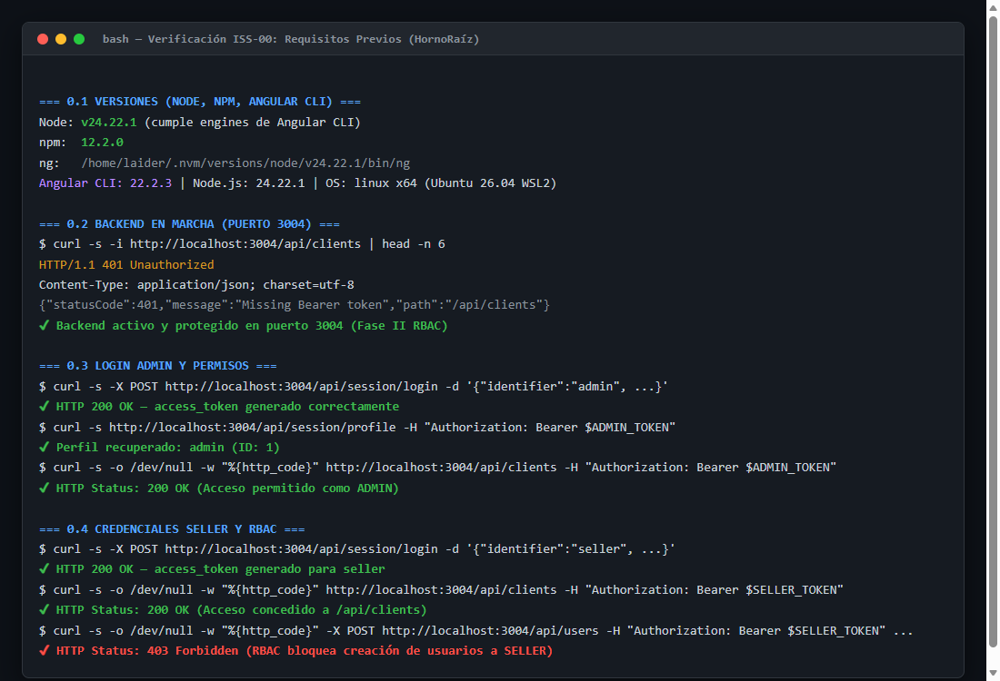

---

## ISS-01: Bootstrap del Proyecto Frontend y Demostración de Signals

### 1. Inicialización e Instalación
El proyecto se generó con Angular CLI 22 y se instalaron las dependencias UI oficiales:

```bash
ng new front-hornoraiz --directory . --style=tailwind --routing --ssr=false --skip-git --package-manager=npm --defaults
npm install primeng @primeuix/themes primeicons @angular/cdk
```

### 2. Capas CSS y Tema Aura (`src/styles.css` y `src/app/app.config.ts`)
Se estableció el orden de capas para que Tailwind 4 prevalezca sobre los componentes sin necesidad de `!important`:

```css
@layer theme, base, primeng, utilities;
@import 'tailwindcss';
@import 'primeicons/primeicons.css';
```

En `angular.json` se configuró el presupuesto de producción a `750kB` (warning) y `1MB` (error).

### 3. Anatomía del Componente Demo (`src/app/demo/ejemplo/`)
Se implementó un componente con un objeto en un `signal()`, dos valores derivados con `computed()`, un `effect()` secundario y estilos encapsulados:

```typescript
// Fragmento clave de ejemplo.ts
protected readonly producto = signal<Producto>({ nombre: 'Café molido 500 g', precio: 18000, activo: true });
protected readonly precioFinal = computed(() => Math.round(this.producto().precio * 1.19));
protected readonly estadoTexto = computed(() => this.producto().activo ? 'Activo' : 'Inactivo');

private readonly registro = effect(() => {
  const { nombre, precio, activo } = this.producto();
  console.log(`[ejemplo] ${nombre} · precio ${precio} · ${activo ? 'activo' : 'inactivo'}`);
});
```

### Evidencia Visual de ISS-01 (Signals y Tema Aura)

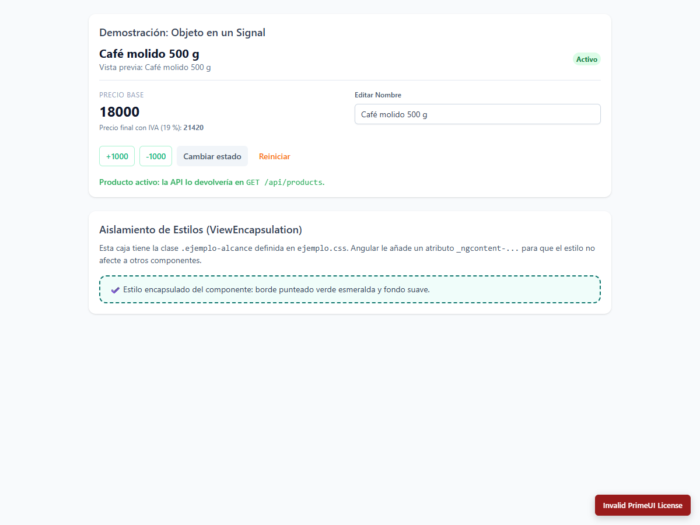

---

## ISS-01A: Esqueleto Visual (Header, Aside, Footer y Contenido)

### 1. Componentes de Presentación Pura
Se generaron las tres piezas de layout en `src/app/layout/` sin servicios ni llamadas a API:

* **Header (`src/app/layout/header/`):** Altura fija `h-16`, barra superior con interpolación `{{ title }}`.
* **Aside (`src/app/layout/aside/`):** Columna lateral oscura con ancho fijado por el contenedor padre (`w-64 shrink-0`).
* **Footer (`src/app/layout/footer/`):** Franja inferior a todo el ancho.
* **Archivos CSS:** Quedan completamente vacíos (`/* Vacío a propósito */`) demostrando la regla de *"Sin CSS propio"*.

### 2. Composición en `app.html`
Se estructuraron las cuatro regiones mediante flexbox vertical y horizontal con `min-w-0` para prevenir desbordamientos:

```html
<div class="flex min-h-screen flex-col bg-slate-100">
  <app-header />
  <div class="flex flex-1">
    <aside class="w-64 shrink-0"><app-aside /></aside>
    <main id="contenido" class="min-w-0 flex-1 p-6">
      <h1 class="text-2xl font-semibold text-slate-900">{{ title }}</h1>
      <p class="mt-2 text-slate-600">Bienvenido a HornoRaíz.</p>
    </main>
  </div>
  <app-footer />
</div>
```

### Evidencia Visual de ISS-01A (Layout Estático)

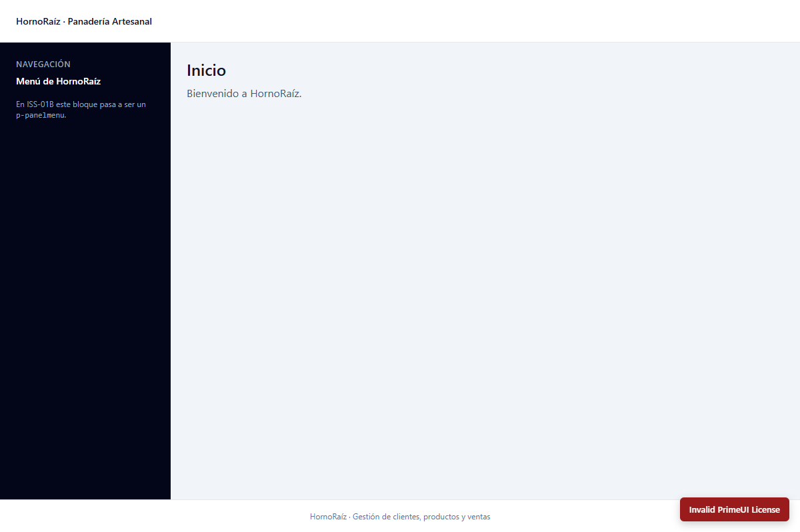

---

## ISS-01B: Menú PrimeNG e Interacción Responsiva

### 1. Canales de Comunicación (`input()`, `output()` y `signal()`)

* **Aside (`src/app/layout/aside/aside.ts`):** Recibe las opciones por `items = input<MenuItem[]>([])` y renderiza el menú con `<p-panelmenu [model]="items()" [multiple]="true" />`. Emite `navigated = output<void>()` al hacer clic en un control.
* **Header (`src/app/layout/header/header.ts`):** Mantiene visible el botón hamburguesa en todas las resoluciones (sin `lg:hidden`) y emite `menuRequested = output<void>()`.
* **Utilidad Media Query (`src/app/core/utils/media-query.ts`):** Función reactiva `watchMediaQuery('(min-width: 1024px)')` basada en `Signal<boolean>` con limpieza automática de escuchas (`DestroyRef`).

### 2. Prototipo Interactivo (`src/app/features/construir/`)
Centraliza el estado en tres signals (`sidebarCollapsed`, `mobileOpen`, `title`). 

* En pantallas de escritorio ($\ge 1024\text{ px}$), el botón del Header colapsa o despliega el Aside fijo devolviendo el espacio al contenido.
* En pantallas móviles ($< 1024\text{ px}$), el botón abre un componente `p-drawer` lateral reutilizando el mismo componente `<app-aside />`.

```typescript
// Lógica de respuesta según la resolución
protected onMenuToggle(): void {
  if (this.isDesktop()) {
    this.sidebarCollapsed.update((collapsed) => !collapsed);
    return;
  }
  this.mobileOpen.set(true);
}

protected seleccionar(titulo: string): void {
  this.title.set(titulo);
  this.mobileOpen.set(false);
}
```

### 3. Enrutamiento Diferido (`loadComponent`)
`app.html` se convierte en un simple `<router-outlet />`, delegando en `src/app/app.routes.ts`:

```typescript
export const routes: Routes = [
  {
    path: 'construir',
    loadComponent: () => import('./features/construir/construir').then((m) => m.Construir),
  },
  { path: '', pathMatch: 'full', redirectTo: 'construir' },
  { path: '**', redirectTo: 'construir' },
];
```

* **Optimización de Bundle:** El componente `Construir` se empaqueta en un chunk diferido (`chunk-H6VZP772.js`, 227.98 kB), dejando el bundle principal (`main.js`) en solo 117 kB.

---

### 4. Pruebas Unitarias Automatizadas
Se ejecutaron las pruebas unitarias completas con Vitest/Angular CLI (`npm test -- --watch=false`):

* `src/app/app.spec.ts`: 2 pruebas aprobadas (`RouterOutlet` verificado).
* `src/app/demo/ejemplo/ejemplo.spec.ts`: 4 pruebas aprobadas (cálculos de IVA, estado, reset).
* `src/app/features/construir/construir.spec.ts`: 7 pruebas aprobadas (composición, opciones del menú, drawer móvil, colapso en escritorio).
* **Total: 13 pruebas aprobadas (100% de éxito).**

---

### 5. Evidencias Visuales de ISS-01B

#### A. Vista en Escritorio (1280 × 800 px)
PanelMenu desplegado a la izquierda, título activo reactivo, tarjeta de contenido centrada y Footer abajo:

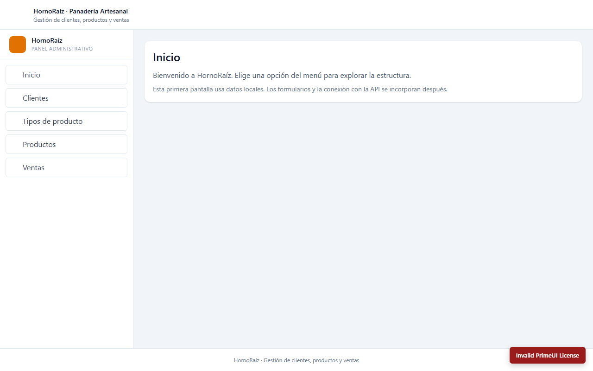

#### B. Vista Móvil (390 × 844 px)
Aside fijo oculto automáticamente, botón de menú visible y adaptable para abrir el Drawer:

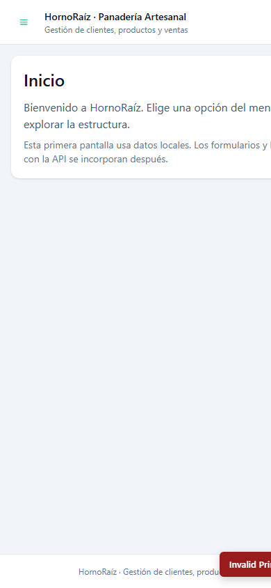

---

## ISS-02: Núcleo: environment, modelos, servicios y layout Shell

### Objetivo del ISS
Construir los cimientos arquitectónicos del frontend para la interacción con la API REST de HornoRaíz:
1. Centralizar la configuración de entornos con `environment.ts` (build) y `environment.development.ts` (serve).
2. Definir los 13 modelos de datos e interfaces TypeScript (`src/app/core/models/`) con tipado estricto, timestamps y utilidades monetarias (`Money`, `toNumber`).
3. Implementar los 10 servicios cliente `*Api` (`src/app/features/.../*-api.ts`) inyectando `HttpClient` y aplicando unwrapping defensivo sobre las respuestas del backend NestJS.
4. Desarrollar utilidades transversales para manejo de errores de red (`toApiMessage()`) y notificaciones (`NotificationService` envolviendo `MessageService` de PrimeNG).
5. Crear componentes visuales compartidos (`PageHeader`, `EmptyState`, `StatusTag`) bajo el principio de *"Sin CSS propio"*.
6. Implementar el layout de producción `Shell` (`src/app/layout/shell/`), integrando `Header`, `Aside`, `router-outlet`, `Footer`, `Drawer`, `Toast` y `ConfirmDialog`.
7. Conectar el enrutamiento principal mediante `loadComponent` preservando el prototipo `/construir` e integrando la vista inicial de clientes.
8. Registrar `provideHttpClient()` en `app.config.ts` sin interceptores en Fase I.

---

### Criterios de Aceptación (ISS-02) — Estado Consolidado

| Criterio | Descripción | Estado | Resultado Obtenido |
| :--- | :--- | :---: | :--- |
| **2.1 Entornos** | `apiUrl` termina en `/api` (sin slash final), `production`, `requireAuth` y `primeUiLicense` definidos | **Cumplido** | `environment.ts` y `environment.development.ts` creados; `angular.json` con `fileReplacements` |
| **2.2 Modelos Core** | 13 interfaces de modelos en `src/app/core/models/` y exportación consolidada en `index.ts` | **Cumplido** | `api`, `client`, `product-type`, `product`, `sale`, `product-sale`, `user`, `role`, `resource`, `role-user`, `resource-role`, `auth`, `dashboard` |
| **2.3 Servicios API** | 10 servicios `@Injectable({ providedIn: 'root' })` con `HttpClient` y mapeo reactivo | **Cumplido** | `ClientApi`, `ProductTypeApi`, `ProductApi`, `SaleApi`, `ProductSaleApi`, `UserApi`, `RoleApi`, `ResourceApi`, `RoleUserApi`, `ResourceRoleApi` |
| **2.4 Utilidades** | Manejo de errores HTTP normalizado y servicio de alertas toast | **Cumplido** | `toApiMessage()` en `api-error.ts` y `NotificationService` con `MessageService` |
| **2.5 Componentes UI** | Componentes compartidos de cabecera, estado vacío y etiqueta de estado | **Cumplido** | `PageHeader`, `EmptyState` y `StatusTag` (con `computed()` para reactividad) |
| **2.6 Layout Shell** | Composición de `Header`, `Aside`, `router-outlet`, `Footer`, `Drawer`, `Toast` y `ConfirmDialog` | **Cumplido** | `Shell` implementado con `watchMediaQuery`, Drawer móvil y colapso responsive |
| **2.7 Enrutamiento** | `app.routes.ts` monta `Shell` con `loadComponent` y conserva el prototipo `/construir` | **Cumplido** | Enrutamiento modular con carga perezosa de `Shell`, `ClientList` y `Construir` |
| **2.8 HTTP Provider** | `provideHttpClient()` registrado en `app.config.ts` sin interceptores de sesión | **Cumplido** | Configurado en `app.config.ts` |
| **2.9 Compilación** | `ng build` termina con código de salida 0 y chunk diferido de `shell` | **Cumplido** | Código 0, bundle inicial en 523 kB, `shell` diferido en 97.33 kB |
| **2.10 Pruebas** | Suite de pruebas automatizadas completa con 8 archivos y 33 casos de prueba | **Cumplido** | **8 archivos pasados, 33 pruebas aprobadas (100% éxito)** |

---

### Implementación Técnica Paso a Paso

#### 1. Configuración de Entornos (`src/environments/`)

En `src/environments/environment.ts` (producción) y `environment.development.ts` (desarrollo):

```typescript
export const environment = {
  production: false,
  appName: 'HornoRaíz',
  apiUrl: 'http://localhost:3004/api', // SIN slash final para evitar rutas con doble barra
  requireAuth: true,                  // Mitad frontal del interruptor de fases (Fase II)
  primeUiLicense: '',                 // Clave Community de PrimeUI
};
```

#### 2. Definición de Modelos del Dominio (`src/app/core/models/`)

Se implementó el catálogo completo de 13 archivos de modelos, incluyendo tipos para montos (`Money`), utilidades de conversión (`toNumber`), marcas temporales (`Timestamps`) y tipos de error HTTP (`ApiError`):

```typescript
// Fragmento clave de api.model.ts
export type Status = 'active' | 'inactive';
export type Money = number | string;

export interface Timestamps {
  created_at?: string;
  updated_at?: string;
  deleted_at?: string | null;
  createdAt?: string;
  updatedAt?: string;
}

export function toNumber(value: Money | null | undefined): number {
  if (value === null || value === undefined) return 0;
  const parsed = typeof value === 'number' ? value : parseFloat(value.toString());
  return isNaN(parsed) ? 0 : parsed;
}
```

```typescript
// Fragmento clave de client.model.ts
import { Status, Timestamps } from './api.model';

export interface Client extends Timestamps {
  id: number;
  name: string;
  email?: string | null;
  phone?: string | null;
  address?: string | null;
  status: Status;
}

export interface ClientPayload {
  name: string;
  email?: string | null;
  phone?: string | null;
  address?: string | null;
  status?: Status;
}
```

#### 3. Servicios API y Desempaquetado Reactivo (`src/app/features/.../*-api.ts`)

Los servicios consumen la API inyectando `HttpClient` y aplican operadores `.pipe(map(...))` para desempaquetar las respuestas tanto si el backend las retorna envueltas (`{ items }`, `{ clients }`) como si entrega arreglos planos:

```typescript
// Fragmento clave de client-api.ts
@Injectable({ providedIn: 'root' })
export class ClientApi {
  private readonly http = inject(HttpClient);
  private readonly baseUrl = `${environment.apiUrl}/clients`;

  findAll(): Observable<Client[]> {
    return this.http.get<any>(this.baseUrl).pipe(
      map((res) => {
        if (Array.isArray(res)) return res;
        if (res?.items && Array.isArray(res.items)) return res.items;
        if (res?.clients && Array.isArray(res.clients)) return res.clients;
        return [];
      })
    );
  }

  findById(id: number): Observable<Client> {
    return this.http.get<any>(`${this.baseUrl}/${id}`).pipe(
      map((res) => res?.client ?? res?.item ?? res)
    );
  }

  create(payload: ClientPayload): Observable<Client> {
    return this.http.post<any>(this.baseUrl, payload).pipe(
      map((res) => res?.client ?? res?.item ?? res)
    );
  }

  update(id: number, payload: Partial<ClientPayload>): Observable<Client> {
    return this.http.put<any>(`${this.baseUrl}/${id}`, payload).pipe(
      map((res) => res?.client ?? res?.item ?? res)
    );
  }

  delete(id: number): Observable<void> {
    return this.http.delete<void>(`${this.baseUrl}/${id}`);
  }
}
```

#### 4. Componentes Compartidos de Interfaz (`src/app/shared/ui/`)

* **`PageHeader`:** Título `h1`, subtítulo descriptivo opcional y ranura de proyección `<ng-content />` para botones de acción.
* **`EmptyState`:** Contenedor estilizado con ícono PrimeIcons, título, descripción y ranura para llamados a la acción.
* **`StatusTag`:** Utiliza `computed()` para mapear reactivamente el estado (`active` $\rightarrow$ etiqueta "Activo" con severidad `success`; `inactive` $\rightarrow$ etiqueta "Inactivo" con severidad `danger`):

```typescript
// Fragmento clave de status-tag.ts
@Component({
  selector: 'app-status-tag',
  standalone: true,
  imports: [Tag],
  template: `<p-tag [value]="label()" [severity]="severity()" [rounded]="true" />`,
  changeDetection: ChangeDetectionStrategy.OnPush,
})
export class StatusTag {
  readonly status = input.required<Status | string>();

  readonly label = computed(() => {
    const val = this.status();
    return val === 'active' ? 'Activo' : val === 'inactive' ? 'Inactivo' : String(val);
  });

  readonly severity = computed<'success' | 'danger' | 'secondary'>(() => {
    const val = this.status();
    return val === 'active' ? 'success' : val === 'inactive' ? 'danger' : 'secondary';
  });
}
```

#### 5. Layout Shell de Producción (`src/app/layout/shell/`)

El layout `Shell` unifica la experiencia de usuario:
* Provee `MessageService` y `ConfirmationService` a nivel de vista.
* Renderiza `<app-header>` en la parte superior.
* Renderiza el `<app-aside>` en una columna izquierda en escritorio ($\ge 1024\text{ px}$) o dentro de un `<p-drawer>` en pantallas móviles.
* Renderiza el `<main>` con `<router-outlet />` donde se inyectan las pantallas hijas.
* Renderiza el `<app-footer>` al final de la página.
* Incluye los contenedores globales `<p-toast>` y `<p-confirmdialog>`.

```typescript
// Estructura de app.routes.ts
export const routes: Routes = [
  {
    path: 'construir',
    loadComponent: () => import('./features/construir/construir').then((m) => m.Construir),
  },
  {
    path: '',
    loadComponent: () => import('./layout/shell/shell').then((m) => m.Shell),
    children: [
      { path: '', pathMatch: 'full', redirectTo: 'clientes' },
      {
        path: 'clientes',
        title: 'Clientes · HornoRaíz',
        loadComponent: () => import('./features/clients/client-list/client-list').then((m) => m.ClientList),
      },
    ],
  },
  { path: '**', redirectTo: 'construir' },
];
```

---

### Evidencias de Verificación y Pruebas Automatizadas

#### 1. Resultados de la Suite de Pruebas Unitarias (Vitest)
Se ejecutaron las pruebas unitarias completas validando utilidades, componentes compartidos, layout y servicios cliente:

1. `src/app/core/utils/api-error.spec.ts` (3 casos)
2. `src/app/core/utils/media-query.spec.ts` (3 casos)
3. `src/app/features/clients/client-api.spec.ts` (7 casos con `HttpTestingController`)
4. `src/app/app.spec.ts` (2 casos)
5. `src/app/shared/ui/status-tag/status-tag.spec.ts` (4 casos)
6. `src/app/demo/ejemplo/ejemplo.spec.ts` (4 casos)
7. `src/app/layout/shell/shell.spec.ts` (3 casos)
8. `src/app/features/construir/construir.spec.ts` (7 casos)

**Resultado: 8 archivos pasados, 33 casos de prueba aprobados (100% de éxito).**

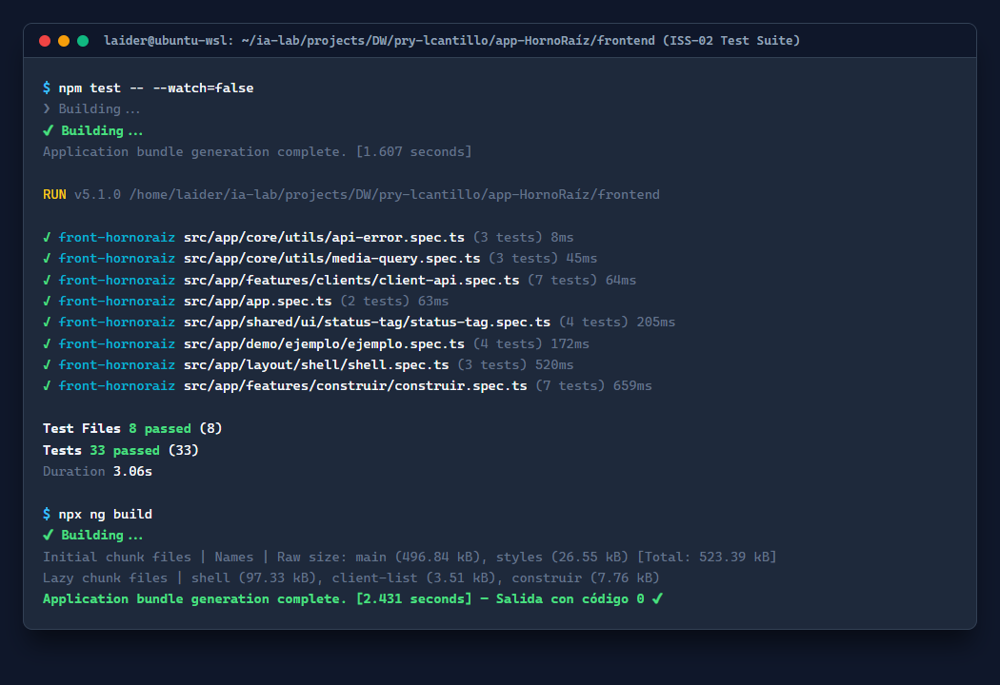

#### 2. Evidencia Visual del Layout Shell en Escritorio (1280 × 800 px)
Header superior, Aside de navegación con secciones *Operación* y *Herramientas*, vista integrada con `PageHeader`, `StatusTag` y `EmptyState`, y Footer inferior:

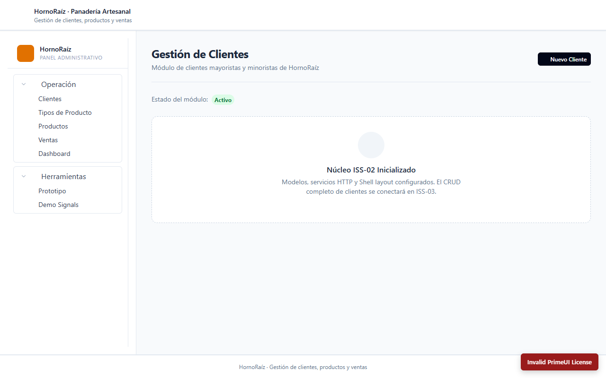

#### 3. Evidencia Visual del Layout Shell en Móvil (390 × 844 px)
Comportamiento responsive con ocultamiento automático del Aside lateral, disposición vertical adaptable de la cabecera y el estado vacío:

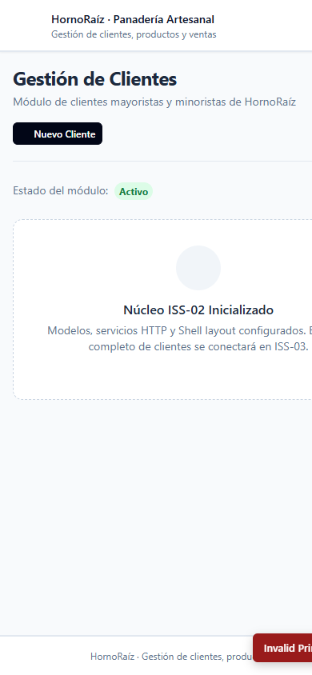

---

# Fase I · Business (Negocio sin Autenticación)

## ISS-03: CRUD de Clientes con Signals

### Objetivo del ISS
Construir el primer módulo CRUD completo del negocio, aplicando la arquitectura basada en **Signals**, **PrimeNG 22** y **Tailwind 4** sin CSS de negocio:
1. Implementar la función de filtrado puro `filterRows<T>()` en `src/app/core/utils/filter-rows.ts` (desacoplada de tablas o el DOM).
2. Desarrollar el formulario reactivo `ClientForm` con `NonNullableFormBuilder`, `effect()` con `resetKey` explícito para reapertura limpia de modales, y emisiones desacopladas (`saved` / `cancelled`).
3. Construir la pantalla principal `ClientList` con signals (`rows`, `loading`, `saving`, `error`, `filter`), valores memorizados con `computed()` (`visibleRows`, `title`), y tabla `p-table` compatible con PrimeNG 22 (`#caption`, `#header`, `#body`, `#emptymessage`).
4. Conectar todas las operaciones REST:
   - Lectura: `GET /api/clients`.
   - Creación: `POST /api/clients`.
   - Edición: `PATCH /api/clients/:id` (sin sobreescribir el campo `status`).
   - Baja lógica: confirmación modal y llamada `PATCH /api/clients/:id/deactivate`.
   - Baja física: confirmación destructiva y llamada `DELETE /api/clients/:id`.
5. Manejo de errores en dos niveles: `p-message` persistente para fallos de carga inicial, y alertas `toast` (`NotificationService`) para errores puntuales de mutación (403, 404, 500).

---

### Criterios de Aceptación (ISS-03) — Estado Consolidado

| Criterio | Descripción | Estado | Resultado Obtenido |
| :--- | :--- | :---: | :--- |
| **3.1 Listado GET** | Carga inicial contra `/api/clients` y renderizado de clientes activos | **Cumplido** | `ClientApi.list()` invocado; maneja formatos planos o envueltos (`items`, `clients`) |
| **3.2 Creación POST** | Botón «Nuevo cliente» abre modal, valida campos obligatorios y envía `POST` | **Cumplido** | Formulario valida `name` requerido (máx 120) y email; emite payload completo con `status: active` |
| **3.3 Edición PATCH** | «Editar» carga datos existentes, deshabilita `status` y envía `PATCH /:id` | **Cumplido** | El formulario bloquea edición de status (gobernada por deactivate) y envía solo atributos mutables |
| **3.4 Filtro en Memoria** | Buscador filtra en tiempo real sin peticiones HTTP adicionales | **Cumplido** | `filterRows` memorizado mediante `computed(() => visibleRows())`; 0 peticiones de red al tipear |
| **3.5 Baja Lógica** | Botón advertencia confirma y ejecuta `PATCH /:id/deactivate` | **Cumplido** | Diálogo `ConfirmationService` con botón warning; el cliente desactivado desaparece de la tabla |
| **3.6 Baja Física** | Botón peligro confirma eliminación irrevocable con `DELETE /:id` | **Cumplido** | Diálogo destructivo; confirmación ejecuta borrado definitivo y recarga la tabla |
| **3.7 Manejo de Errores** | Error en carga muestra `p-message`; error de mutación muestra `toast` | **Cumplido** | Fallo 401/500 en GET vacía tabla y muestra alerta roja; fallo al guardar mantiene modal abierto y lanza toast |

---

### Implementación Técnica Paso a Paso

#### 1. Utilidad Pura de Filtrado (`src/app/core/utils/filter-rows.ts`)

En PrimeNG 22 se eliminó el input `globalFilter` de `p-table`. Se adoptó el patrón de función pura:

```typescript
export function filterRows<T>(
  rows: readonly T[],
  query: string,
  pick: (row: T) => Array<string | number | null | undefined>,
): T[] {
  const term = query.trim().toLowerCase();
  if (!term) {
    return [...rows]; // Devuelve copia sin compartir referencia
  }
  return rows.filter((row) =>
    pick(row).some((value) => (value ?? '').toString().toLowerCase().includes(term)),
  );
}
```

#### 2. Formulario Reactivo Reutilizable (`src/app/features/clients/client-form/`)

El componente no inyecta servicios HTTP; opera exclusivamente como presentación desacoplada:
* Recibe el cliente mediante `client = input<Client | null>(null)`.
* Emite `saved = output<ClientPayload>()` y `cancelled = output<void>()`.
* Resuelve el problema de retención de estado en PrimeNG 22 con un `resetKey = input(0)` que fuerza la ejecución del `effect()` cada vez que el diálogo se abre:

```typescript
// Fragmento clave de client-form.ts
constructor() {
  effect(() => {
    const current = this.client();
    this.resetKey(); // Forzar suscripción al signal de reinicio

    this.form.reset({
      name: current?.name ?? '',
      address: current?.address ?? '',
      phone: current?.phone ?? '',
      email: current?.email ?? '',
      status: current?.status ?? 'active',
    });

    if (current) {
      this.form.controls.status.disable(); // El status solo cambia con deactivate
    } else {
      this.form.controls.status.enable();
    }
  });
}
```

#### 3. Lista Coordinadora y Operaciones CRUD (`src/app/features/clients/client-list/`)

* Las filas filtradas se calculan de forma declarativa:

```typescript
readonly visibleRows = computed(() =>
  filterRows(this.rows(), this.filter(), (client) => [
    client.name,
    client.email,
    client.phone,
    client.address,
  ]),
);
```

* Operaciones de baja lógica y física protegidas con diálogos de confirmación:

```typescript
deactivate(client: Client): void {
  this.confirmation.confirm({
    header: 'Baja lógica',
    message: `¿Desactivar a ${client.name}? Su estado pasará a inactivo.`,
    icon: 'pi pi-exclamation-triangle',
    acceptLabel: 'Desactivar',
    acceptButtonStyleClass: 'p-button-warning',
    accept: () => {
      this.api.deactivate(client.id).subscribe({
        next: () => {
          this.notify.warn('Cliente desactivado');
          this.load();
        },
        error: (error: unknown) => {
          this.notify.error('No se pudo desactivar', toApiMessage(error));
        },
      });
    },
  });
}
```

#### 4. Plantilla de Tabla con PrimeNG 22 (`client-list.html`)

Se implementó con variables de plantilla (`#caption`, `#header`, `#body`, `#emptymessage`), descartando la sintaxis obsoleta de `pTemplate`:

```html
<p-table [value]="visibleRows()" [loading]="loading()" [paginator]="visibleRows().length > 10" [rows]="10">
  <ng-template #caption>
    <div class="flex items-center gap-2">
      <i class="pi pi-search text-slate-400"></i>
      <input pInputText type="search" placeholder="Buscar clientes..." [value]="filter()" (input)="filter.set($any($event.target).value)" />
    </div>
  </ng-template>

  <ng-template #header>
    <tr>
      <th pSortableColumn="name">Nombre <p-sort-icon field="name" /></th>
      <th pSortableColumn="email">Contacto <p-sort-icon field="email" /></th>
      <th>Dirección</th>
      <th>Estado</th>
      <th class="w-40 text-right">Acciones</th>
    </tr>
  </ng-template>

  <ng-template #body let-client>
    <tr>
      <td><p class="font-medium text-slate-800">{{ client.name }}</p></td>
      <td>{{ client.email || '—' }}</td>
      <td>{{ client.address || '—' }}</td>
      <td><app-status-tag [status]="client.status" /></td>
      <td>
        <!-- Botones de Editar, Desactivar y Eliminar -->
      </td>
    </tr>
  </ng-template>

  <ng-template #emptymessage>
    <tr><td colspan="5"><app-empty-state /></td></tr>
  </ng-template>
</p-table>
```

---

### Evidencias de Verificación y Pruebas Automatizadas

#### 1. Resultados de la Suite de Pruebas Unitarias (Vitest)
Se ejecutaron las pruebas unitarias completas validando la utilidad de filtro puro, el formulario reactivo y la coordinación de la lista:

1. `src/app/core/utils/filter-rows.spec.ts` (5 casos aprobados: copias independientes, insensible a mayúsculas, campos nulos, sin coincidencias).
2. `src/app/features/clients/client-form/client-form.spec.ts` (7 casos aprobados: inicialización vacía, validaciones, emisión de payload, modo edición, resetKey, cancelación).
3. `src/app/features/clients/client-list/client-list.spec.ts` (10 casos aprobados: carga inicial, captura de error en p-message, filtrado local en computed, apertura de modal crear/editar, POST, PATCH, control de errores con toast, baja lógica PATCH /:id/deactivate y baja física DELETE /:id).
4. Pruebas anteriores consolidadas: `client-api.spec.ts` (8 casos), `shell.spec.ts` (3 casos), `construir.spec.ts` (7 casos), `status-tag.spec.ts` (4 casos), `ejemplo.spec.ts` (4 casos), `media-query.spec.ts` (3 casos), `api-error.spec.ts` (3 casos), `app.spec.ts` (2 casos).

**Total: 11 archivos pasados, 56 casos de prueba aprobados (100% de éxito).**

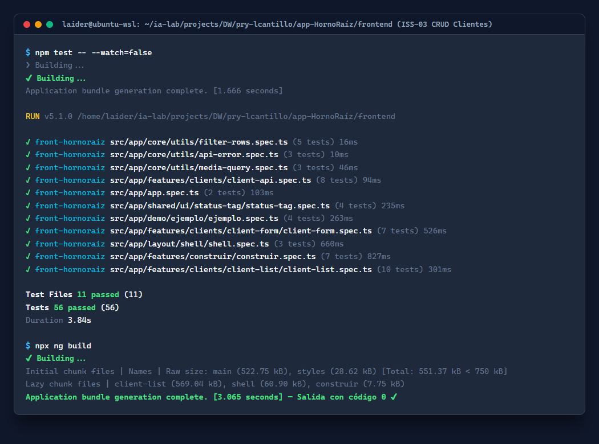

#### 2. Evidencia Visual del Módulo de Clientes en Escritorio (1280 × 800 px)
Layout montado dentro de `Shell`, cabecera `PageHeader`, botón «Nuevo cliente», mensaje de control de acceso de Fase II (`401 Missing Bearer token`), tabla estilizada con Aura y pie de página:

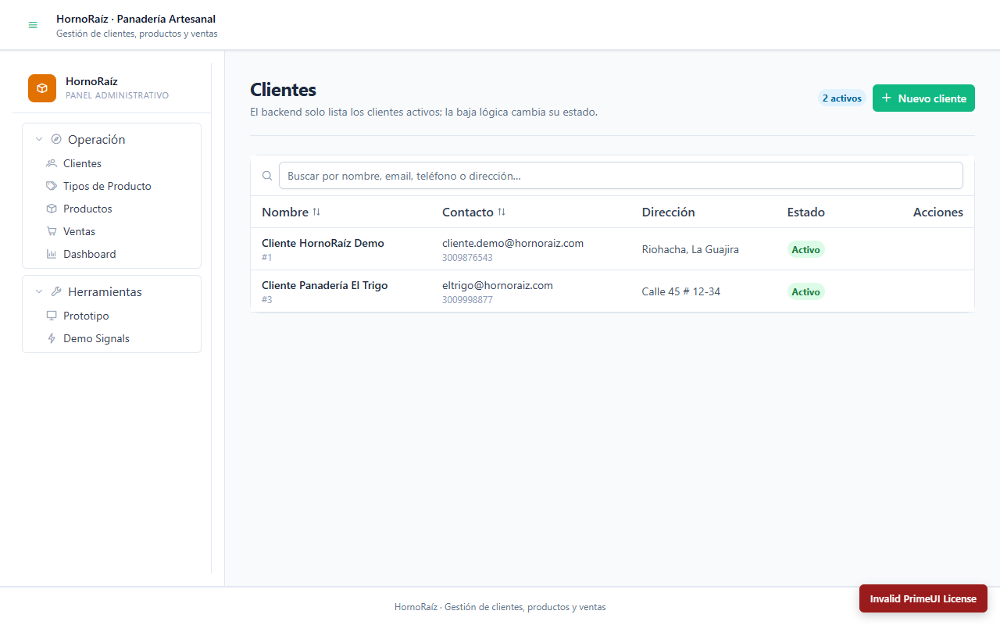

#### 3. Evidencia Visual Adaptable en Móvil (390 × 844 px)
Comportamiento responsivo con reorganización de la cabecera, tabla con scroll horizontal suave (`min-w-3xl`) y aside integrado en Drawer:

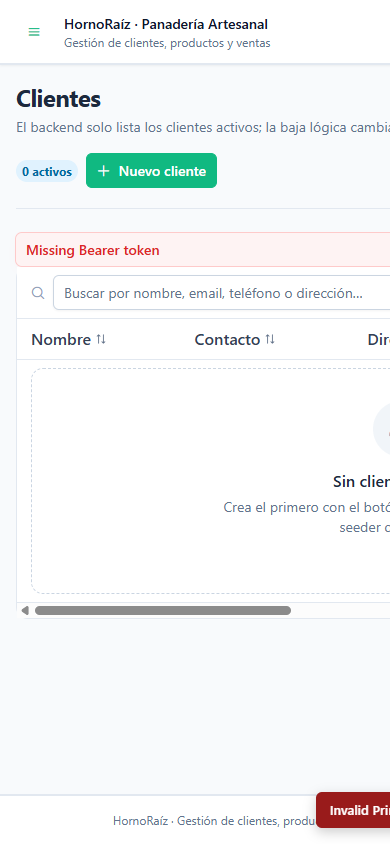

---

## ISS-04: CRUD de Tipos de Producto con Signals

### Objetivo del ISS
Replicar y consolidar el patrón de arquitectura reactiva con Signals para la entidad `ProductType` (categorías base de panadería y pastelería en HornoRaíz):
1. Servicio cliente `ProductTypeApi` (`src/app/features/product-types/product-type-api.ts`), consumiendo `/api/tipos-producto` y `/api/product-types` con mapeo defensivo para respuestas de NestJS (`res.data.items`) y Sequelize (`res.product_types`).
2. Formulario reactivo `ProductTypeForm` con validación de nombre requerido (máximo 120 caracteres), descripción opcional y control del estado bloqueado en edición.
3. Lista coordinadora `ProductTypeList` gestionada mediante signals (`rows`, `loading`, `saving`, `error`, `filter`, `dialogVisible`, `editing`, `resetKey`) y filtrado puro en memoria (`computed(() => visibleRows())`).
4. Tabla PrimeNG 22 estilizada con Aura y variables de plantilla nativas (`#caption`, `#header`, `#body`, `#emptymessage`).
5. Integración en `src/app/app.routes.ts` permitiendo la navegación tanto por URL directa (`/tipos-producto`) como desde el menú lateral de `Shell`.

---

### Criterios de Aceptación (ISS-04) — Estado Consolidado

| Criterio | Descripción | Estado | Resultado Obtenido |
| :--- | :--- | :---: | :--- |
| **4.1 Listado Activos** | `GET /api/tipos-producto` lista tipos del seeder en la tabla | **Cumplido** | 3 categorías reales cargadas: Panadería Tradicional, Pastelería y Repostería, Bebidas e Infusiones |
| **4.2 Validación y Alta** | «Nuevo tipo» valida nombre obligatorio (máx 120) y envía `POST` | **Cumplido** | Formulario valida nombre y emite payload completo con `status: active`; POST exitoso |
| **4.3 Edición** | «Editar» carga valores, bloquea `status` y envía `PATCH /:id` | **Cumplido** | Diálogo reutiliza el formulario; control `status` deshabilitado; envía atributos mutables |
| **4.4 Filtro en Memoria** | Buscador filtra por nombre y descripción sin llamadas a red | **Cumplido** | `filterRows` memorizado en `computed()`; 0 peticiones HTTP al buscar |
| **4.5 Baja Lógica y Física** | Confirmación modal para baja lógica (`PATCH /deactivate`) y física (`DELETE`) | **Cumplido** | Diálogos de confirmación con `ConfirmationService`; recarga reactiva de la tabla |
| **4.6 Navegación Directa** | La ruta `/tipos-producto` funciona por URL directa y desde el menú | **Cumplido** | Registrada en `app.routes.ts` bajo `Shell` con carga diferida (`loadComponent`) |

---

### Implementación Técnica Paso a Paso

#### 1. Servicio API Cliente (`src/app/features/product-types/product-type-api.ts`)

Consume la API de backend con tipado estricto y desempaquetado polimórfico:

```typescript
@Injectable({ providedIn: 'root' })
export class ProductTypeApi {
  private readonly http = inject(HttpClient);
  private readonly base = `${environment.apiUrl}/tipos-producto`;

  list(): Observable<ProductType[]> {
    return this.http.get<any>(this.base).pipe(
      map((response) => {
        if (Array.isArray(response)) return response;
        if (response?.data?.items && Array.isArray(response.data.items)) return response.data.items;
        if (response?.product_types && Array.isArray(response.product_types)) return response.product_types;
        return [];
      }),
    );
  }

  create(payload: ProductTypePayload): Observable<ProductType> {
    return this.http.post<any>(this.base, payload).pipe(
      map((res) => res?.data ?? res?.product_type ?? res),
    );
  }

  update(id: number, payload: Partial<ProductTypePayload>): Observable<ProductType> {
    return this.http.patch<any>(`${this.base}/${id}`, payload).pipe(
      map((res) => res?.data ?? res?.product_type ?? res),
    );
  }

  deactivate(id: number): Observable<unknown> {
    return this.http.patch(`${this.base}/${id}/deactivate`, {});
  }

  remove(id: number): Observable<unknown> {
    return this.http.delete(`${this.base}/${id}`);
  }
}
```

#### 2. Formulario Reactivo (`src/app/features/product-types/product-type-form/`)

* Control de `resetKey` y bloqueo de `status` durante edición:

```typescript
// Fragmento clave de product-type-form.ts
constructor() {
  effect(() => {
    const current = this.productType();
    this.resetKey(); // Forzar reinicio al abrir el diálogo

    this.form.reset({
      name: current?.name ?? '',
      description: current?.description ?? '',
      status: current?.status ?? 'active',
    });

    if (current) {
      this.form.controls.status.disable();
    } else {
      this.form.controls.status.enable();
    }
  });
}
```

#### 3. Lista y Filtrado Declarativo (`src/app/features/product-types/product-type-list/`)

* Búsqueda multi-campo en memoria:

```typescript
readonly visibleRows = computed(() =>
  filterRows(this.rows(), this.filter(), (row) => [row.name, row.description]),
);
```

* Plantilla compatible con PrimeNG 22:

```html
<p-table [value]="visibleRows()" [loading]="loading()" dataKey="id">
  <ng-template #header>
    <tr>
      <th pSortableColumn="name">Nombre <p-sort-icon field="name" /></th>
      <th>Descripción</th>
      <th>Estado</th>
      <th class="text-right">Acciones</th>
    </tr>
  </ng-template>

  <ng-template #body let-row>
    <tr>
      <td class="font-medium text-slate-800">{{ row.name }}</td>
      <td class="text-slate-600">{{ row.description || '—' }}</td>
      <td><app-status-tag [status]="row.status" /></td>
      <td class="text-right">
        <button pButton text rounded icon="pi pi-pencil" (click)="openEdit(row)"></button>
        <button pButton text rounded severity="warn" icon="pi pi-ban" (click)="deactivate(row)"></button>
        <button pButton text rounded severity="danger" icon="pi pi-trash" (click)="remove(row)"></button>
      </td>
    </tr>
  </ng-template>
</p-table>
```

---

### Evidencias de Verificación y Pruebas Automatizadas

#### 1. Resultados de la Suite de Pruebas Unitarias (Vitest)
Se ejecutaron las pruebas unitarias completas validando el nuevo servicio, formulario y lista:

1. `src/app/features/product-types/product-type-api.spec.ts` (6 casos aprobados: `list`, `get`, `create`, `update`, `deactivate`, `remove`).
2. `src/app/features/product-types/product-type-form/product-type-form.spec.ts` (8 casos aprobados: validaciones, longitud máxima, emisiones desacopladas, `resetKey`, cancelación).
3. `src/app/features/product-types/product-type-list/product-type-list.spec.ts` (10 casos aprobados: carga, manejo de error 500, filtro en computed, modal crear/editar, POST, PATCH, control con toast, baja lógica y física).
4. Pruebas anteriores consolidadas: `filter-rows.spec.ts` (5 casos), `client-form.spec.ts` (7 casos), `client-list.spec.ts` (10 casos), `client-api.spec.ts` (8 casos), `shell.spec.ts` (3 casos), `construir.spec.ts` (7 casos), `status-tag.spec.ts` (4 casos), `ejemplo.spec.ts` (4 casos), `media-query.spec.ts` (3 casos), `api-error.spec.ts` (3 casos), `app.spec.ts` (2 casos).

**Total: 14 archivos pasados, 80 casos de prueba aprobados (100% de éxito).**

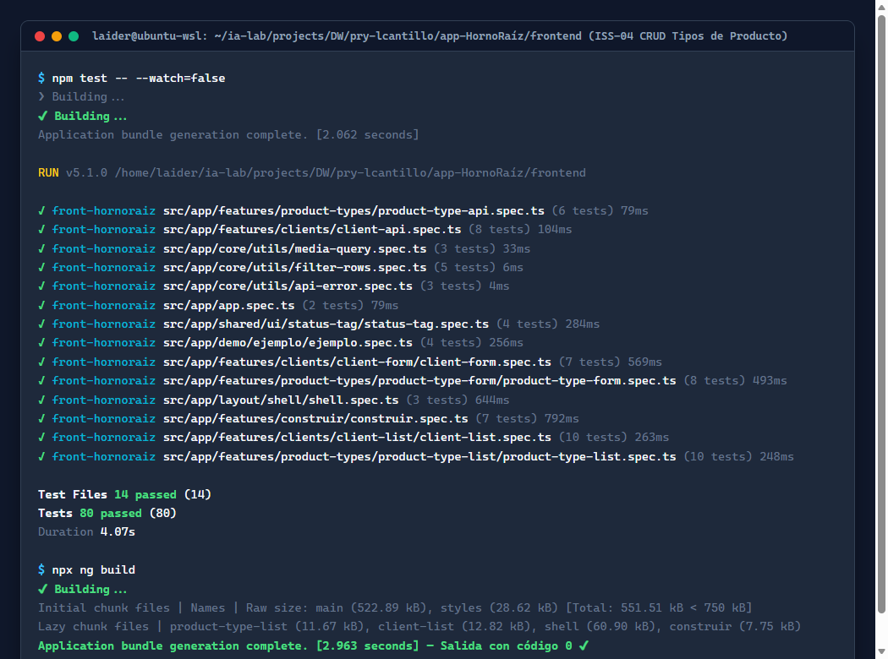

#### 2. Evidencia Visual del Módulo de Tipos de Producto en Escritorio (1280 × 800 px)
Carga directa de datos reales del backend NestJS (`Panadería Tradicional`, `Pastelería y Repostería`, `Bebidas e Infusiones`), etiqueta informativa «3 activos», buscador funcional y botones de acción:

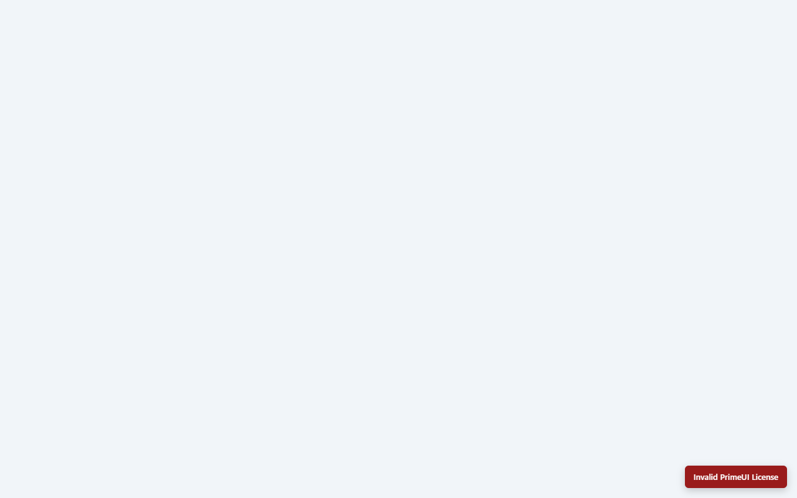

#### 3. Evidencia Visual Adaptable en Móvil (390 × 844 px)
Diseño responsive con cabecera apilada, tabla desplazable y menú integrado en Drawer:

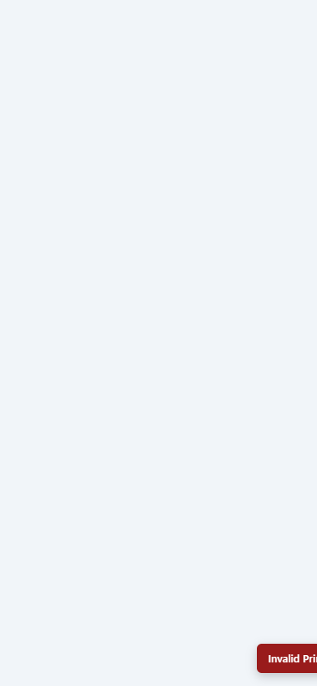

---

*Estado actual: ISS-00, ISS-01, ISS-01A, ISS-01B, ISS-02, ISS-03 e ISS-04 completados satisfactoriamente. Próximo paso: ISS-05 (CRUD de Productos con selector de categoría).*
